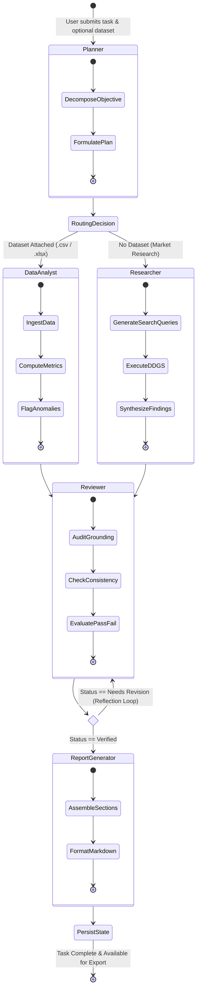
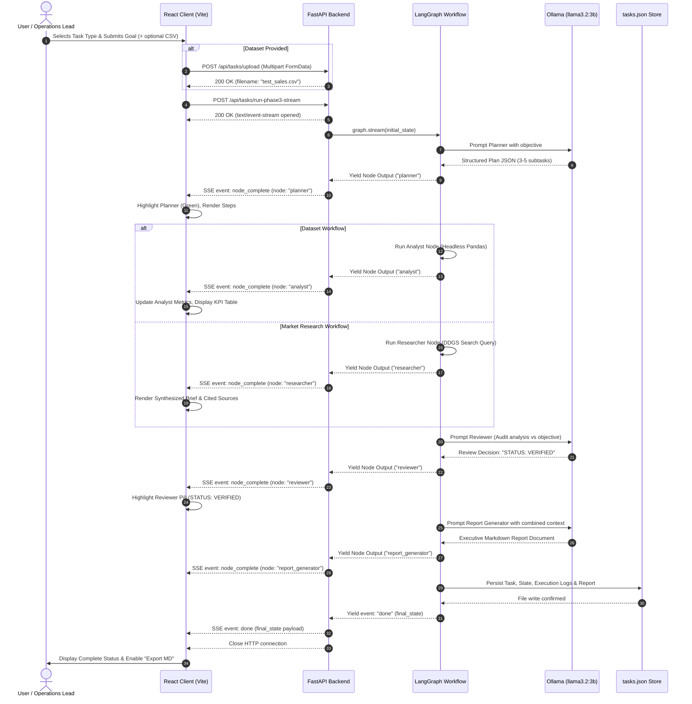

<div align="center">

# 🤖 AgentFlow AI

**AgentFlow AI — Autonomous Business Operations Agent**

[](https://fastapi.tiangolo.com)
[](https://github.com/langchain-ai/langgraph)
[](https://reactjs.org/)
[](https://www.typescriptlang.org/)
[](https://tailwindcss.com/)
[](https://ollama.ai)

<br/>


<br/>

<p align="center">
  <b>Dynamic Agent Routing • Headless Pandas Analysis • DuckDuckGo Web Intelligence • Quality Audit Gate • Real-Time SSE Streams</b>
</p>

[System Architecture](#-system-architecture) •
[Agent Workflow (Mermaid)](#-agent-workflow--state-graph) •
[Sequence Flow](#-real-time-sse-sequence-flow) •
[Features](#-key-features) •
[Getting Started](#-getting-started) •
[API Reference](#-api-endpoints) •
[Docker Deployment](#-docker-deployment)

</div>

---

## 📌 Executive Summary

Concept: An AI system that accepts a business task, plans how to complete it, delegates work to specialized AI agents, uses tools, checks the results, and generates a final report with evidence.

Modern enterprise operations require both **deterministic analytical precision** (e.g., CSV/Excel statistical breakdowns, KPI calculations) and **unstructured dynamic intelligence** (live web research and market updates). 

**AgentFlow AI** unifies these two execution paradigms into an autonomous, cyclical **LangGraph** state machine:

- **Local Inference First**: Designed out of the box for locally-hosted models (e.g., `llama3.2:3b` or `mistral` via Ollama) to guarantee data privacy, compliance, and zero recurring API costs.
- **Dynamic Branch Routing**: The planning layer analyzes task directives and file attachments, routing tasks to either deterministic data analytics or live web research.
- **Audit & Self-Correction**: A dedicated Reviewer QA gate verifies analytical calculations and factual grounding, providing an iterative reflection loop prior to document synthesis.
- **Real-Time Visibility**: Server-Sent Events (SSE) stream node transitions, execution status, and payloads live to a reactive React dashboard.
- **Durable Persistence**: Flat-file JSON storage (`backend/data/tasks.json`) ensures task history, metrics, and generated reports persist across server restarts.

---

## 🏗 System Architecture

The following diagram illustrates the relationship between the client interface, API streaming layer, LangGraph state engine, and the underlying persistence and inference tools:

```mermaid
graph TB
    subgraph UI["Frontend Layer (React 18 + Vite + TailwindCSS)"]
        Dashboard["Dashboard & Metrics Ring"]
        NewTask["New Task Form & SSE Monitor"]
        WorkflowView["Live Graph Visualizer"]
        LogViewer["Searchable Audit Logs"]
        ReportViewer["Markdown Report & Export"]
    end

    subgraph API["Backend Gateway (FastAPI)"]
        SSE["/api/tasks/run-phase3-stream<br/>(SSE Streaming Engine)"]
        Upload["/api/tasks/upload<br/>(File Service)"]
        REST["/api/tasks/stats & /logs<br/>(REST API)"]
    end

    subgraph Graph["LangGraph Execution Engine"]
        Planner["Planner Agent<br/>(Goal Decomposition)"]
        Branch{"Router<br/>(Dataset Attached?)"}
        Analyst["Data Analyst Agent<br/>(Headless Pandas Execution)"]
        Researcher["Researcher Agent<br/>(DuckDuckGo / DDGS Search)"]
        Reviewer["Reviewer Agent<br/>(Quality Audit & Verification)"]
        Critique{"QA Gate<br/>(Verified?)"}
        Reporter["Report Generator Agent<br/>(Executive Synthesis)"]
    end

    subgraph Storage["Persistence & Tools Layer"]
        TasksDB[("tasks.json<br/>Persistence Store")]
        UploadsDir[("uploads/<br/>CSV/Excel Datasets")]
        OllamaEngine["Ollama Runtime<br/>(Local LLM: llama3.2:3b)"]
        WebEngine["DuckDuckGo Engine<br/>(Live Web Query)"]
    end

    %% Connections
    NewTask -->|Upload File| Upload
    Upload --> UploadsDir
    NewTask -->|Initiate Task| SSE
    SSE --> Planner
    REST <--> TasksDB

    Planner --> Branch
    Branch -- "Has CSV/Excel" --> Analyst
    Branch -- "No Dataset" --> Researcher

    Analyst <--> UploadsDir
    Researcher <--> WebEngine

    Analyst --> Reviewer
    Researcher --> Reviewer

    Reviewer --> Critique
    Critique -- "Pass (Verified)" --> Reporter
    Critique -- "Fail (Discrepancy)" -->|Reflection Loop| Reviewer

    Reporter --> TasksDB
    TasksDB -.-> Dashboard
    TasksDB -.-> LogViewer
    TasksDB -.-> ReportViewer
    SSE -.->|Real-Time SSE Events| WorkflowView
    SSE -.->|Live Node Stream| NewTask

    Planner -.-> OllamaEngine
    Reviewer -.-> OllamaEngine
    Reporter -.-> OllamaEngine
```

---

## 🔬 Agent Workflow & State Graph

AgentFlow AI models agent interactions as a directed cyclical graph with conditional branching and reflection:



---

## 🔄 Real-Time SSE Sequence Flow

This sequence diagram details the communication between the browser, FastAPI backend, LangGraph state engine, and external tools during execution:



---

## ✨ Key Features

### 1. Dynamic Agent Routing & LangGraph Execution
- **Planner Agent**: Evaluates user goals, decomposes input into a multi-step execution agenda, and evaluates payload requirements. Breaks the request into subtasks, identifies required tools, and creates an execution plan.
- **Data Analyst Agent**: Reads uploaded CSV, Excel, or PDF reports and calculates trends, KPIs, and anomalies using Python tools. Automatically calculates summary metrics, null counts, distributions, and variance metrics.
- **Researcher Agent**: Uses live web search integration (`ddgs`) with fallback handling to gather competitive intelligence, industry updates, and cited sources.Researches potential explanations and solutions using approved search tools or internal company documents.
- **Reviewer Agent**: Checks calculations, verifies evidence, identifies unsupported claims, and requests revisions when necessary.
- **Report Generator Agent**: Produces an executive summary, charts, recommended actions, priorities, and a downloadable report.

### 2. Full-Stack SSE Streaming Engine
- Real-time updates delivered to the browser over `text/event-stream`.
- Visual progress tracking across Planner, Analyst/Researcher, Reviewer, and Report nodes with instant step completion status.

### 3. Comprehensive Dashboard & Persistence
- Live calculation of total tasks, completed runs, failure rate, running tasks, and interactive SVG completion-rate meters.
- File-backed persistent storage layer preserving runs, audit logs, and reports across service restarts.
- Download reports directly as formatted `.md` documents with one click.

### 4. Interactive Diagnostics & Logs UI
- Filterable execution logs (by agent, severity level, or task query).
- Expandable JSON payload viewer to inspect raw agent states and intermediate execution data.
- Live topology visualization displaying active graph nodes and branches.

---

This project combines autonomous AI agents with a modern web interface to process user requests, retrieve relevant information from business documents, execute specialized tasks, and deliver structured responses.

The backend manages business logic, agent orchestration, API endpoints, document retrieval, and LLM integration.

---

## ✨ Key Features

- **Multi-Agent Architecture:** Specialized AI agents collaborate to complete complex tasks.
- **Agent Orchestration:** CrewAI manages agent collaboration and task delegation.
- **Workflow Management:** LangGraph controls workflow state, conditional routing, and review loops.
- **RAG Pipeline:** Retrieve relevant information from business documents using vector search.
- **Semantic Search:** Qdrant stores and searches document embeddings.
- **LLM Integration:** Support for local models through Ollama and hosted models through the Gemini API.
- **REST API:** FastAPI provides backend endpoints for the frontend.
- **Interactive Dashboard:** React provides a modern interface for submitting requests and viewing results.
- **Human-in-the-Loop:** Allow users to review or approve important outputs before finalization.
- **Error Handling:** Handle failed tasks, invalid inputs, and unsuccessful model responses.

---

## 🛠️ Technology Stack

| Technology | Purpose |
|---|---|
| Python | Backend development and AI logic |
| FastAPI | REST API and backend services |
| CrewAI | Multi-agent collaboration |
| LangGraph | Stateful agent workflows and conditional routing |
| LangChain | LLM integration and retrieval utilities |
| Ollama | Run supported LLMs locally |
| Gemini API | Hosted LLM inference |
| Qdrant | Vector database and semantic search |
| React | Frontend user interface |
| Bolt.new | Frontend scaffolding and UI development |
| Git & GitHub | Version control and project hosting |

---

## 📂 Project Directory Structure

```
AgentFlow/
├── assets/
│   └── agentflow-architecture.png # Architecture UI flowchart banner
├── backend/
│   ├── agents/
│   │   ├── analyst_agent.py      # Pandas data processing & statistical KPIs
│   │   ├── planner_agent.py      # Goal decomposition & strategy generation
│   │   ├── report_agent.py       # Final document synthesis
│   │   ├── researcher_agent.py   # Web intelligence gathering
│   │   ├── reviewer_agent.py     # Verification & quality assurance audit
│   │   └── workflow.py           # LangGraph StateGraph assembly & edges
│   ├── api/
│   │   └── routes.py             # FastAPI REST endpoints & SSE streaming
│   ├── data/
│   │   └── tasks.json            # File-backed persistence store
│   ├── services/
│   │   ├── file_service.py       # Upload validation & disk management
│   │   └── storage_service.py    # Atomic read/write operations for tasks
│   ├── tools/
│   │   ├── data_tools.py         # Tabular data manipulation functions
│   │   └── search_tools.py       # DuckDuckGo/DDGS query wrappers
│   ├── uploads/                  # Input datasets (.csv, .xlsx)
│   ├── .env                      # Local environment variables
│   ├── main.py                   # FastAPI initialization, CORS & static SPA mount
│   └── requirements.txt          # Python runtime dependencies
├── frontend/
│   ├── src/
│   │   ├── components/
│   │   │   ├── layout/           # Sidebar, navigation, top bar
│   │   │   └── ui/               # Card, Button, StatusPill, StateWrapper
│   │   ├── data/                 # Sample fallback structures
│   │   ├── pages/
│   │   │   ├── AgentWorkflow.tsx # Graph visualization & agent status polling
│   │   │   ├── Dashboard.tsx     # Metrics, KPIs & recent activity list
│   │   │   ├── ExecutionLogs.tsx # Searchable audit trail with payload inspector
│   │   │   ├── NewTask.tsx       # Task submission form with live SSE monitor
│   │   │   └── Reports.tsx       # Markdown report viewer & file export
│   │   ├── services/
│   │   │   └── api.ts            # Client API client & SSE stream processor
│   │   ├── types/
│   │   │   └── index.ts          # Unified TypeScript interfaces
│   │   ├── App.tsx               # Primary application routing
│   │   └── main.tsx              # React DOM entrypoint
│   ├── package.json
│   ├── tailwind.config.js
│   ├── tsconfig.app.json
│   └── vite.config.ts
├── Dockerfile                    # Multi-stage production container build
├── docker-compose.yml            # Container orchestration with Ollama bridge
├── .env.example                  # Environment template
└── test_sales.csv                # Sample dataset for testing
```

---

## 🚀 Getting Started

### Prerequisites

- **Python**: `>= 3.10`
- **Node.js**: `>= 18.x`
- **Ollama**: Running locally with a downloaded model (e.g., `llama3.2:3b` or `mistral`)

```bash
# Pull your desired model in Ollama
ollama pull llama3.2:3b
```

### Local Development Setup

#### 1. Backend Setup

```bash
# Navigate to backend
cd backend

# Create and activate virtual environment
python -m venv venv
source venv/bin/activate  # On Windows: venv\Scripts\activate

# Install dependencies
pip install -r requirements.txt ddgs

# Configure environment
cp .env.example .env

# Run FastAPI backend
uvicorn main:app --reload --port 8000
```

Verify backend health at: `http://localhost:8000/health` or open interactive Swagger docs at `http://localhost:8000/docs`.

#### 2. Frontend Setup

```bash
# Navigate to frontend (in a new terminal)
cd frontend

# Install npm dependencies
npm install

# Start Vite dev server
npm run dev
```

Open `http://localhost:5173` in your browser.

---

## 📡 API Endpoints

| Method | Route | Description |
| :--- | :--- | :--- |
| `GET` | `/health` | Healthcheck and active service probe |
| `POST` | `/api/tasks/upload` | Multipart file upload for CSV/Excel datasets |
| `POST` | `/api/tasks/run-phase3` | Synchronous end-to-end multi-agent execution |
| `POST` | `/api/tasks/run-phase3-stream` | **SSE Streaming**: Live node-by-node execution stream |
| `GET` | `/api/tasks` | Retrieve all historical tasks |
| `GET` | `/api/tasks/stats` | Aggregated metrics (Total, Completed, Failed, Running) |
| `GET` | `/api/tasks/agents` | Status query for all workflow graph nodes |
| `GET` | `/api/tasks/logs` | Chronological execution audit trail |
| `GET` | `/api/tasks/reports` | List all synthesized executive reports |
| `GET` | `/api/tasks/reports/{id}` | Retrieve individual markdown report by ID |

---

## 🐳 Docker Deployment

To build and run the entire stack (FastAPI backend + compiled React SPA) in a unified container:

```bash
# Build and start container
docker compose up --build -d

# Verify container status
docker ps

# Stream logs
docker compose logs -f
```

The application will be accessible at `http://localhost:8000`. Persistence volumes for `tasks.json` and uploaded datasets map directly into your local directory.

---

## 🛡 License

This project is licensed under the MIT License — see the [LICENSE](LICENSE) file for details.